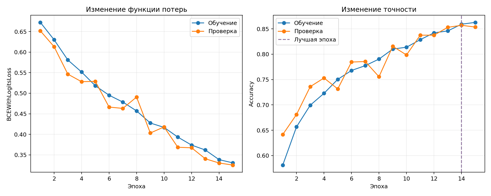
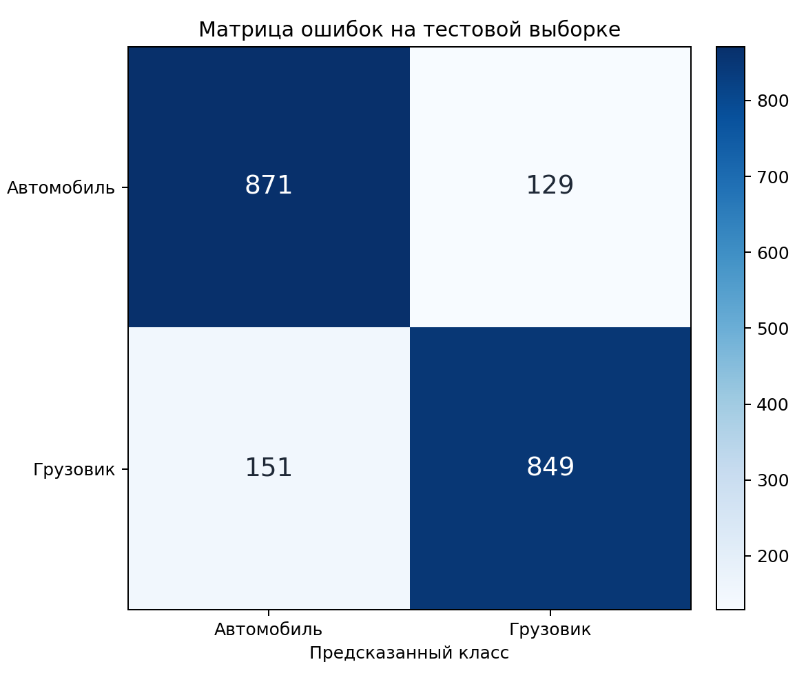
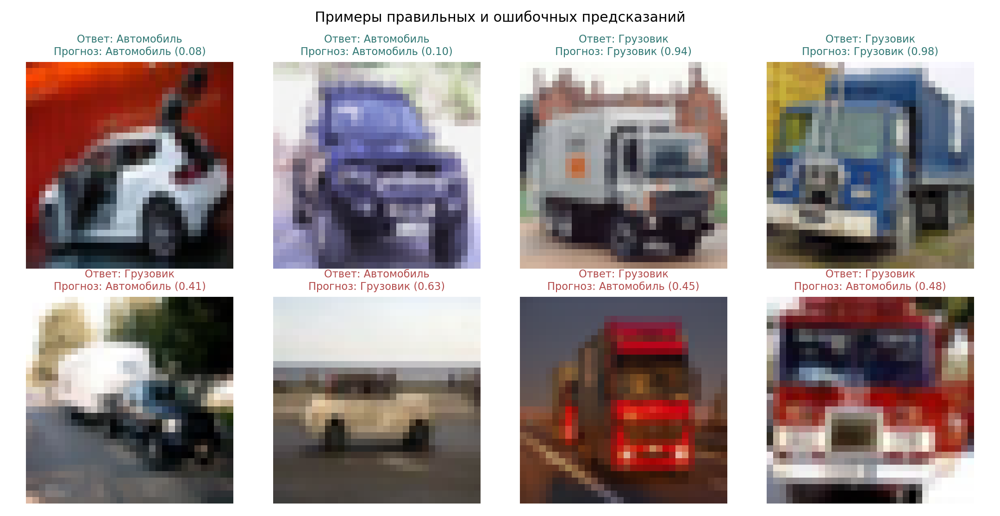

# Лабораторная работа №3. Классификация изображений с помощью CNN

| Табельный номер | ФИО | Группа |
| :-------------: | ------------------ | :----: |
| 563798 | Гребенщиков Д. А. | Р4140 |

## Цель работы

Реализовать свёрточную нейронную сеть для классификации автомобилей и грузовиков, оценить качество на отложенных данных и проверить наличие переобучения

## Краткая теория

Свёрточная нейронная сеть получает изображение и постепенно выделяет признаки. Первые слои находят простые границы и текстуры. Следующие слои объединяют их в более сложные части объекта

Свёрточный слой перемещает небольшое ядро по изображению. Для каждой позиции вычисляется взвешенная сумма пикселей:

```text
feature[i, j] = sum(image_window * kernel) + bias
```

`image_window` является участком изображения, `kernel` содержит обучаемые веса фильтра. Во время обучения сеть подбирает веса, которые помогают различать автомобили и грузовики

После свёртки применяется функция активации ReLU:

```text
ReLU(x) = max(0, x)
```

ReLU оставляет положительные значения и заменяет отрицательные нулём. MaxPool уменьшает ширину и высоту карт признаков, сохраняя наиболее сильное значение в каждом небольшом участке

Последний слой возвращает одно число `logit`. Сигмоида переводит его в вероятность класса «грузовик»:

```text
p = 1 / (1 + exp(-logit))
```

Если `p` не меньше `0.5`, сеть выбирает грузовик. В остальных случаях выбирается автомобиль

## Условия эксперимента

Использованы два класса набора `CIFAR-10`: `automobile` и `truck`. Изображения являются цветными и имеют размер `32 x 32` пикселя. Датасет автоматически загружается через `torchvision` в пользовательский каталог кэша

| Параметр | Значение |
|---|---:|
| Обучающая выборка | 8 000 изображений |
| Валидационная выборка | 2 000 изображений |
| Тестовая выборка | 2 000 изображений |
| Баланс | одинаковое число изображений каждого класса |
| Начальное состояние генератора | `42` |
| Размер пакета | `128` |
| Число эпох | `15` |
| Оптимизатор | Adam |
| Скорость обучения | `0.001` |
| Функция потерь | `BCEWithLogitsLoss` |
| Правило выбора модели | максимальная validation accuracy |
| Основная метрика | accuracy |

Валидационная выборка используется для выбора лучшей эпохи. Тестовая выборка применяется один раз после завершения обучения для итоговой оценки

## Алгоритм работы

1. Скачать CIFAR-10 и оставить изображения автомобилей и грузовиков
2. Разделить исходную обучающую часть на обучение и валидацию
3. Перевести значения пикселей в диапазон от `-1` до `1`
4. Случайно отражать обучающие изображения по горизонтали
5. Выполнить прямой проход и вычислить функцию потерь
6. Распространить ошибку назад и обновить веса сети
7. После каждой эпохи проверить модель на валидационной выборке
8. Сохранить веса с максимальной валидационной accuracy
9. Рассчитать итоговые метрики на тестовой выборке

## Реализация

### Подготовка данных

В CIFAR-10 автомобиль имеет номер `1`, грузовик номер `9`. В программе они преобразуются в классы `0` и `1`

```python
SOURCE_CLASSES = {1: 0, 9: 1}

class_indexes = _indexes_for_classes(source_train.targets, generator)
train_indexes = torch.cat([values[:4000] for values in class_indexes.values()])
validation_indexes = torch.cat([values[4000:] for values in class_indexes.values()])
```

Из каждого класса берётся 4000 изображений для обучения и 1000 для валидации. Индексы не пересекаются. Тестовые изображения берутся из отдельной тестовой части CIFAR-10

Для обучения добавляется случайное горизонтальное отражение. Оно создаёт новый вариант изображения без изменения класса

```python
train_transform = transforms.Compose(
    [
        transforms.RandomHorizontalFlip(),
        transforms.ToTensor(),
        transforms.Normalize((0.5, 0.5, 0.5), (0.5, 0.5, 0.5)),
    ]
)
```

Полная подготовка данных находится в [`source/data.py`](source/data.py)

### Архитектура сети

```text
Изображение 3 x 32 x 32
→ Conv 3 x 3, 32 канала → ReLU → MaxPool
→ Conv 3 x 3, 64 канала → ReLU → MaxPool
→ Conv 3 x 3, 128 каналов → ReLU
→ AdaptiveAvgPool
→ Dropout 0.3
→ Linear 128 → 1
```

Три свёрточных слоя последовательно увеличивают число каналов с 32 до 128. `AdaptiveAvgPool` оставляет по одному среднему значению для каждого канала. `Dropout` во время обучения случайно отключает часть значений и снижает зависимость сети от отдельных признаков

```python
self.features = nn.Sequential(
    nn.Conv2d(3, 32, kernel_size=3, padding=1),
    nn.ReLU(),
    nn.MaxPool2d(2),
    nn.Conv2d(32, 64, kernel_size=3, padding=1),
    nn.ReLU(),
    nn.MaxPool2d(2),
    nn.Conv2d(64, 128, kernel_size=3, padding=1),
    nn.ReLU(),
    nn.AdaptiveAvgPool2d(1),
)
```

Полная модель находится в [`source/model.py`](source/model.py)

### Обучение сети

`BCEWithLogitsLoss` объединяет сигмоиду и бинарную функцию потерь. Это позволяет устойчиво выполнять вычисления при больших по модулю значениях `logit`

На каждой итерации сеть получает пакет изображений, вычисляет ошибку и обновляет веса:

```python
if training:
    optimizer.zero_grad()

with torch.set_grad_enabled(training):
    logits = model(images)
    loss = criterion(logits, labels.float())

    if training:
        loss.backward()
        optimizer.step()
```

После каждой эпохи вычисляется accuracy на валидационной выборке. Если она стала выше, текущее состояние сети сохраняется:

```python
if validation_accuracy > best_accuracy:
    best_accuracy = validation_accuracy
    best_epoch = epoch
    best_state = copy.deepcopy(model.state_dict())
```

Полный цикл обучения находится в [`source/run.py`](source/run.py)

### Получение класса

При итоговой проверке сигмоида переводит `logit` в вероятность. Порог `0.5` преобразует вероятность в номер класса

```python
probabilities = torch.sigmoid(logits).cpu()
predictions = (probabilities >= 0.5).long()
```

## Структура проекта

```text
computer-vision-lab3/
├── images/
│   ├── training_curves.png    изменение ошибки и accuracy
│   ├── confusion_matrix.png   матрица ошибок
│   └── predictions.png        примеры предсказаний
├── source/
│   ├── data.py                загрузка и разделение данных
│   ├── model.py               архитектура CNN
│   └── run.py                 обучение, проверка и графики
├── requirements.txt           зависимости проекта
└── README.md                  описание работы
```

## Установка и запуск

Для работы нужен Python 3.9 или новее. Видеокарта не обязательна

```bash
python3 -m venv .venv
source .venv/bin/activate
pip install -r requirements.txt
python source/run.py
```

При первом запуске требуется интернет. Датасет сохраняется вне проекта в `~/.cache/computer-vision-lab3` и повторно не скачивается

## Результаты

Эксперимент выполнен один раз на CPU. Для итогового теста использованы веса 14-й эпохи

| Метрика | Значение |
|---|---:|
| Время обучения | 80,7 с |
| Валидационная accuracy | 0,8570 |
| Тестовая accuracy | 0,8600 |
| Precision для грузовиков | 0,8681 |
| Recall для грузовиков | 0,8490 |
| F1 для грузовиков | 0,8584 |

Accuracy показывает долю всех правильных ответов. Precision показывает долю настоящих грузовиков среди изображений, названных грузовиками. Recall показывает долю найденных грузовиков. F1 объединяет precision и recall в одно значение

### Процесс обучения



Функция потерь уменьшается на обучающей и валидационной выборках. Максимальная валидационная accuracy получена на 14-й эпохе. На 15-й эпохе accuracy обучения продолжила расти, а валидационная accuracy уменьшилась с 0,8570 до 0,8535

Валидационные значения местами выше обучающих, поскольку случайное отражение и `Dropout` усложняют только процесс обучения и отключаются при проверке

### Матрица ошибок



Из 1000 автомобилей правильно распознано 871. Из 1000 грузовиков правильно распознано 849. Сеть ошибочно назвала грузовиками 129 автомобилей и пропустила 151 грузовик

### Примеры предсказаний



Основные ошибки возникают на размытых изображениях и при виде объекта спереди или сзади. При разрешении `32 x 32` форма легкового автомобиля и небольшого грузовика иногда выглядит похоже

### Проверка переобучения

На лучшей эпохе accuracy равна 0,8591 на обучении и 0,8570 на валидации. Разница составляет 0,0021, поэтому выраженного переобучения нет. Небольшое снижение валидационной accuracy после 14-й эпохи подтверждает выбор лучшего состояния по валидации

## Ограничения

Модель различает только автомобили и грузовики из CIFAR-10. Низкое разрешение затрудняет распознавание похожих объектов, а результаты одного разбиения не показывают разброс качества при других начальных состояниях

## Вывод

Сеть достигла accuracy 0,8600 на тестовой выборке и почти одинаково распознаёт оба класса. Выбор состояния 14-й эпохи ограничил переобучение, а оставшиеся ошибки связаны с низким разрешением и внешним сходством машин и грузовиков

## Источники

1. [CIFAR-10](https://www.cs.toronto.edu/~kriz/cifar.html)
2. [Torchvision. CIFAR10](https://docs.pytorch.org/vision/stable/generated/torchvision.datasets.CIFAR10.html)
3. [PyTorch. BCEWithLogitsLoss](https://docs.pytorch.org/docs/stable/generated/torch.nn.BCEWithLogitsLoss.html)
